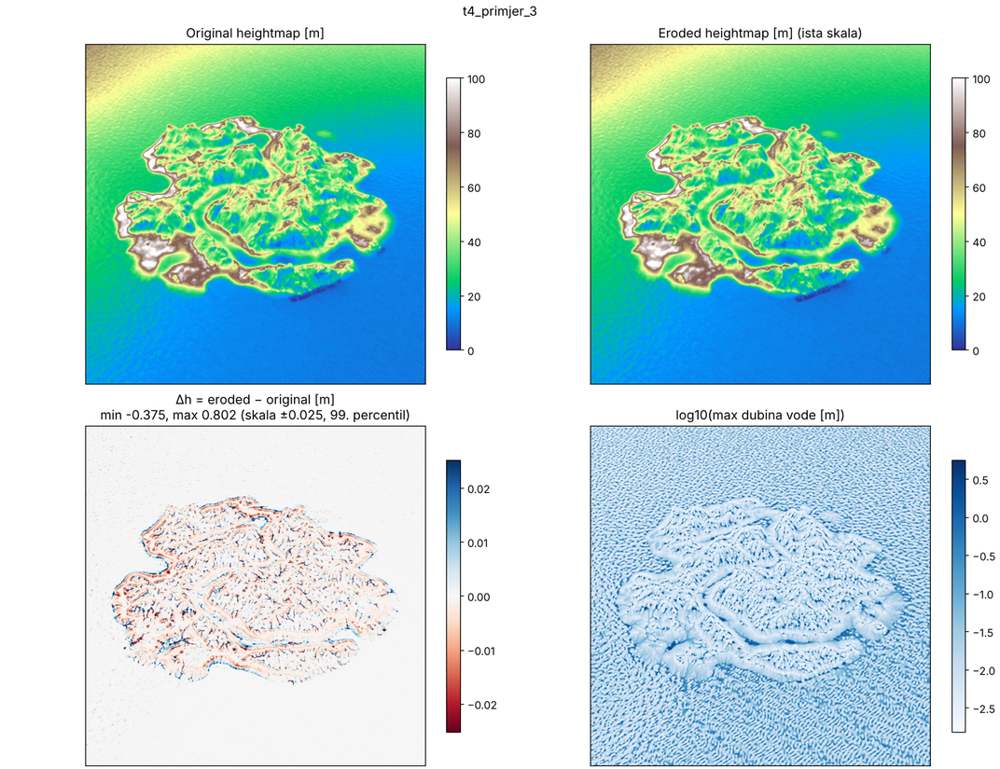

# PRS – Shallow-water and Terrain Erosion

Seminarski projekat iz predmeta **Paralelni računarski sistemi** (ETF Sarajevo).

`prs_erosion` je **konzolni simulator hidrauličke erozije terena** zasnovan na **metodi virtuelnih cijevi**
(Virtual Pipes / hydrostatic pipe model; Mei, Decaudin, Hu 2007; Šťava i dr. 2008). Teren se **odabere na karti
svijeta** (stvarne visine i razmjera se preuzimaju automatski) ili učita iz height mape (PNG ili JPEG). Korisnik
zatim unese ukupnu količinu kiše u L/m² i trajanje u satima, a program numerički simulira tok vode, eroziju,
transport i taloženje sedimenta i zapiše **erodiranu height mapu** – istih dimenzija i u istoj visinskoj skali, sa
stvarno promijenjenim visinama terena.

Ovo je **faza 2** (bez GPU-a). Ranija implementacija (faza 1, CPU benchmark SIMD/OpenMP varijanti `prs_swe`) je
zamijenjena ovom – vidi [odjeljak 13](#13-razlike-u-odnosu-na-fazu-1).

> **Grana `paralelizacija`:** na faza-2 kod je dodana optimizacija i paralelizacija na procesoru (OpenMP i
> `#pragma omp simd`), pa je simulacija oko 5,5× brža. Teren je **bit po bit identičan bez obzira na broj niti**;
> u odnosu na fazu 2 postoji mala razlika u zaokruživanju, jer je formula trenja prepisana da ima jedno dijeljenje
> umjesto dva (izmjereno: do 2,2·10⁻⁵ m na mreži 736 × 736, do 2,3·10⁻³ m na maloj i strmoj mreži). Po zahtjevu AC7
> faza 2 je bila namjerno serijska; `-DPRS_ENABLE_OPENMP=OFF` vraća serijsko izvršavanje, ali ne i staru aritmetiku.

Detaljno objašnjenje modela za odbranu: **[docs/ALGORITHM_EXPLANATION.md](docs/ALGORITHM_EXPLANATION.md)**.

## Sadržaj

1. [Šta aplikacija radi](#1-šta-aplikacija-radi)
2. [Brzi start](#2-brzi-start)
3. [Pokretanje simulacije](#3-pokretanje-simulacije)
4. [Kako se učitava height mapa](#4-kako-se-učitava-height-mapa)
5. [Kako se interpretiraju padavine](#5-kako-se-interpretiraju-padavine)
6. [Kako funkcioniše metoda virtuelnih cijevi](#6-kako-funkcioniše-metoda-virtuelnih-cijevi)
7. [Kako nastaju erozija i depozicija](#7-kako-nastaju-erozija-i-depozicija)
8. [Kako se izvozi erodirana mapa](#8-kako-se-izvozi-erodirana-mapa)
9. [Kompajliranje](#9-kompajliranje)
10. [Testovi](#10-testovi)
11. [Izmjereni rezultati](#11-izmjereni-rezultati)
12. [Ograničenja numeričkog modela](#12-ograničenja-numeričkog-modela)
13. [Razlike u odnosu na fazu 1](#13-razlike-u-odnosu-na-fazu-1)
14. [Struktura projekta](#14-struktura-projekta)
15. [Literatura, reference i licence](#15-literatura-reference-i-licence)

---

## 1. Šta aplikacija radi

```
teren s karte (birač u pregledniku) ──┐  PNG + .terrain.json (stvarna razmjera i visine u metrima)
  ili height mapa iz fajla (PNG/JPEG) ┤
kiša: L/m² i sati ────────────────────┼─► voda teče kroz virtuelne cijevi ─► erozija ─► transport ─► depozicija
skala: m/piksel, min/max (ako nije ───┘          (adaptivni korak Δt, fizičko vrijeme: npr. 5 h = 18000 s)
       došla s karte)                                              │
                                                                   ▼
      erodirana height mapa (16-bitni PNG, ista skala) + mapa razlike + poređenje + dubina vode + izvještaj
```

- **Ulaz:** teren odabran na karti (meni **[1]**) ili height mapa `.png` / `.jpg` / `.jpeg` (crno = najniže,
  bijelo = najviše), ukupna kiša [L/m²], trajanje kiše [h], opcioni period oticanja bez kiše [h]. Fizička skala
  (veličina ćelije, min/max visina) dolazi s karte ili je zadaje korisnik.
- **Izlaz:** `<ime>_eroded.png` – ista height mapa nakon erozije (16 bita, iste dimenzije i orijentacija, ista
  visinska skala kao ulaz), plus vizualizacije, sirovi podaci i izvještaj s bilansima vode i materijala.
- Promjene visine nastaju **isključivo iz modela** (voda → protok → erozija → transport → depozicija), a ne iz
  filtera slike.

## 2. Brzi start

Zahtjevi: **CMake ≥ 3.16** i **C++20 kompajler** (MSVC iz Visual Studio 2022/2026, GCC ≥ 11 ili Clang ≥ 14).
Nema vanjskih zavisnosti – biblioteka za slike (stb) je u `third_party/`. Python je potreban samo za opcione
skripte (`scripts/`).

### Windows (Visual Studio)

**Najkraće:** u PowerShellu u folderu projekta ukucaj `.\Pokreni` (pa u meniju **[1]** odaberi teren na karti). Skripta sama izgradi samo izmijenjene fajlove
(prvi put i konfiguriše CMake) i pokrene program. `.\Pokreni test` pokreće testove, a argumenti se prosljeđuju
programu (`.\Pokreni --input teren.png --rain 100 --hours 3`).

Da bude dovoljno samo `Pokreni` (bez `.\`, iz bilo kojeg foldera), jednom pokreni `scripts\instaliraj_pokreni.cmd`:
dodaje folder projekta u korisnički PATH (bez administratora; poništava se sa `scripts\ukloni_pokreni.cmd`), pa
otvori novi terminal.

Demo (build → testovi → simulacija na priloženom primjeru → slike):

```bat
scripts\erosion_demo.cmd
```

Ili ručno, iz korijena projekta (**Developer PowerShell** ili obični terminal sa CMake-om u `PATH`):

```bat
cmake -S . -B build-vs -G "Visual Studio 17 2022" -A x64
cmake --build build-vs --config Release
build-vs\Release\prs_erosion_tests.exe
build-vs\Release\prs_erosion.exe
```

(Za Visual Studio 2026 generator je `"Visual Studio 18 2026"`; postojeći `build-vs` folder se samo ponovo
izgradi drugom komandom.)

### Linux / macOS

```bash
cmake -S . -B build -DCMAKE_BUILD_TYPE=Release
cmake --build build -j
./build/prs_erosion_tests        # 44 testa, očekuje se "neuspjelih provjera: 0"
./build/prs_erosion              # interaktivni meni
```

## 3. Pokretanje simulacije

Program se pokreće **iz korijena projekta** (rezultati idu u `output/<ime_mape>/`). Teren se može dobiti na tri
načina:

| Način | Kako | Skala terena |
|---|---|---|
| **[1] Karta** (preporučeno) | program otvori birač u pregledniku, teren stiže automatski | automatski (`.terrain.json`) |
| **[2] Fajl** | putanja do PNG/JPEG height mape | iz `.terrain.json` pored slike, inače se unosi |
| **Komandna linija** | `--input … --rain … --hours …` | iz `.terrain.json` ili `--cell/--min/--max` |

### Odabir terena na karti (birač terena)

Umjesto da veličinu ćelije i visine unosiš napamet, teren možeš odabrati na karti. U meniju odaberi **[1] Odaberi teren
na karti**:

1. Program pokrene mali **lokalni server** (samo `127.0.0.1`, nije dostupan s mreže) i otvori birač u pregledniku na
   adresi `http://127.0.0.1:<port>/?token=<nasumični token>`. Na vrhu stranice piše „Povezano s programom“.
2. Pronađi mjesto (pretraga ili pomjeranje karte) i **nacrtaj pravougaonik** ili uzmi „Koristi trenutni pogled“.
3. Izaberi najveću dimenziju slike (zadano 512 px) i klikni **Generiši teren**. Stranica preuzme visinske pločice,
   napravi 16-bitni PNG i metapodatke i **sama ih pošalje programu** – ništa se ne preuzima ručno.
4. Program ih spremi u `tereni/<ime>.png` i `tereni/<ime>.terrain.json`, učita, ispiše metapodatke (veličina ćelije,
   najniža i najviša visina u metrima, koordinate) i pita samo `Koristiti ove vrijednosti terena? [D/n]`. Ostaje kiša.

Dok program čeka preglednik, **Enter** prekida čekanje; tada se koristi rezervni način: preuzmi oba fajla
(„Preuzmi oba fajla“), vrati se u program i pritisni Enter – program nađe najnoviji izvoz u folderu Preuzimanja.
Isti rezervni način se koristi ako se lokalni server ne može pokrenuti. Upload bez ispravnog tokena ili s tuđim
`Host` zaglavljem server odbija, a ime fajla iz preglednika se čisti (nema izlaska iz foldera `tereni/`).

Isto vrijedi za opciju **[2]** i za komandnu liniju: ako pored slike postoji `<ime>.terrain.json`, skala se učita iz
njega (`--terrain-json FAJL` navodi drugi fajl; zadane opcije `--cell/--min/--max` imaju prednost). Ako je slika
kasnije **smanjena** (isti omjer stranica), veličina ćelije se sama preračuna; za promijenjen omjer stranica program
odbija metapodatke i traži ručni unos.

Kako radi i šta treba znati:
- **Podaci:** AWS Terrain Tiles (Mapzen), Terrarium pločice – javne, bez ključa. Visina je kodirana u boji piksela,
  `(R·256 + G + B/256) − 32768` m. Stranica ih čita direktno iz preglednika (bez vanjskog servera, ključa ili instalacije); lokalni server programa
  samo servira stranicu i prima rezultat.
- **Razmjera:** kvadratni pikseli u Web Mercatoru; veličina ćelije = metri po pikselu · cos(geografska širina centra).
- **Stvarna rezolucija podataka** je u većem dijelu svijeta (uključujući BiH) oko **30 m** (SRTM / EU-DEM), pa ćelije
  manje od toga samo interpoliraju i simulacija traje duže bez dodatnih detalja. Stranica na to upozorava.
- **Površinski model:** visine mogu uključivati krošnje/zgrade (SRTM), ne samo golo tlo.
- **Smanjenje slike** u editoru blago ublaži vrhove, pa najviša tačka u smanjenoj slici može biti malo niža od
  vrijednosti u JSON-u. Najbolje je odmah izvesti željenu dimenziju (npr. 512 px).
- **Treba internet** (karta, pločice). Pretraga mjesta koristi Nominatim. Atribucija se prikazuje na stranici i upisuje u
  JSON: „SRTM data courtesy of the U.S. Geological Survey“, „Produced using Copernicus data and information funded by
  the European Union - EU-DEM layers“, Mapzen/AWS Terrain Tiles, © OpenStreetMap contributors.
- Ako program ne može sam otvoriti preglednik, ispiše adresu `http://127.0.0.1:…`; otvori je ručno. Stranica radi i
  otvorena dvoklikom kao fajl – tada se fajlovi preuzimaju ručno (opcija [2]).

### Iz fajla (interaktivno)

Sva pitanja i poruke su na bosanskom. Prazan unos (Enter) uzima zadanu vrijednost u uglastoj zagradi.

```
================================================
      SHALLOW-WATER AND TERRAIN EROSION
                  PRS PROJECT
================================================

[1] Odaberi teren na karti (otvara preglednik)
[2] Učitaj heightmapu iz fajla
[3] Izlaz

Odaberite opciju:
> 2

Unesite putanju do heightmape (.png, .jpg, .jpeg; prazno = povratak na meni):
> assets/heightmaps/primjer_1/height-map-input-try-1-height-map-16bit-texturemap-app-2026-11-08.png

Heightmapa je uspješno učitana!

Rezolucija: 412 x 221 (nije kvadratna)
Format: PNG
Broj kanala: 1
Dubina boje: 16 bita po kanalu

----------------------------------------
KONFIGURACIJA TERENA
----------------------------------------
Veličina ćelije u metrima (širina terena u metrima / broj piksela) [zadano: 30]:
> (Enter)
Minimalna visina u metrima (crni piksel) [zadano: 0]:
> (Enter)
Maksimalna visina u metrima (bijeli piksel) [zadano: 100]:
> (Enter)
Invertovati heightmapu (bijelo = najniže)? [d/N]:
> (Enter)

----------------------------------------
KONFIGURACIJA KIŠE
----------------------------------------
Ukupna količina kiše (L/m2 = mm):
> 100
Trajanje kiše (sati):
> 5
Prosječni intenzitet: 20 mm/h
Period oticanja nakon kiše, bez padavina (sati) [zadano: 0]:
> (Enter)
Rubni uslov (zatvoren = zidovi, otvoren = voda može napustiti mapu) [zatvoren/otvoren, zadano: zatvoren]:
> (Enter)

... SAŽETAK SIMULACIJE ...
Pokrenuti simulaciju? [D/N]:
> d

Pokrećem simulaciju (napredak se osvježava svakih nekoliko sekundi; prekid: Ctrl+C)...

Napredak:   5.0% | t = 0.25 / 5.00 h (kiša)    | koraka 342 | dt 2.227 s | proteklo 1.4 s | preostalo ~27.3 s
...
Napredak: 100.0% | t = 5.00 / 5.00 h (gotovo)  | koraka 10546 | dt 0.252 s | proteklo 44.2 s | preostalo ~0.0 s

----------------------------------------
REZULTATI
----------------------------------------
Simulirano vrijeme: 5 h (5 h kiše + 0 h oticanja)
Vrijeme izvršavanja: 44.23 s (10546 vremenskih koraka, dt 1.3 .. 10 s)
Ukupno erodirani materijal: 161937.37 m3 (zbir svih događaja erozije)
Ukupno istaloženi materijal: 161937.37 m3 (uključujući 3823.65 m3 istaloženo na kraju)
Neto promjena terena: 155285.78 m3 snižen, 155285.78 m3 podignut
Najveća promjena visine: -0.4721 m (erozija) / +0.6399 m (taloženje)
Greška bilansa vode: 1.96e-08 m3 (relativno 2.39e-15)
Greška bilansa materijala: 1.07e-07 m3 (relativno 6.60e-13)
Rezultat je uspješno sačuvan.
```

Između pragova od 5 % program svake ~3 s osvježava isti red (znak `\r`), pa se odmah vidi da radi i kolika je procjena
preostalog vremena, čak i kad jedan prag traje minutama (velike mape, sitne ćelije).

(Skraćen stvarni ispis programa; Linux VM, vidi [odjeljak 11](#11-izmjereni-rezultati).) Neispravan unos
(tekst, negativna kiša, trajanje 0, NaN…) ne ruši program – ispisuje se razlog i pitanje se ponavlja; prazan unos
uzima podrazumijevanu vrijednost; decimalni zarez i tačka su dozvoljeni.

### Komandna linija (bez pitanja – za skripte i ponovljive eksperimente)

```bat
prs_erosion --input assets\heightmaps\primjer_3\mali-otocic-height-map-16bit-texturemap-app-2026-11-08.png --rain 100 --hours 5
prs_erosion --input teren.png --rain 50 --hours 2 --runoff 1 --cell 10 --min 200 --max 900 --boundary open
prs_erosion --input teren.jpg --rain 100 --hours 1 --invert --out output\moj_test --csv
prs_erosion --help
```

| Opcija | Značenje | Podrazumijevano |
|---|---|---|
| `--input`, `--rain`, `--hours` | height mapa, ukupna kiša [L/m²], trajanje [h] | obavezno |
| `--cell`, `--min`, `--max` | veličina ćelije [m], visina crnog i bijelog piksela [m] | 30, 0, 100 |
| `--terrain-json` | metapodaci iz birača terena (zadano `<ime slike>.terrain.json` pored slike) | – |
| `--invert` | bijelo = najniže | ne |
| `--runoff` | period oticanja nakon kiše [h] | 0 |
| `--boundary` | `closed` (zid) ili `open` (voda i sediment mogu izaći) | closed |
| `--manning` | Manningov koeficijent n [s/m^(1/3)] | 0.04 |
| `--infiltration`, `--evaporation` | gubici vode [mm/h] | 0, 0 |
| `--kc`, `--ks`, `--kd` | kapacitet [s/m], brzina erozije i taloženja [1/s] | 0.5, 0.02, 0.02 |
| `--max-concentration`, `--min-slope` | granice kapaciteta | 0.1, 0 |
| `--erodible-depth` | debljina erodibilnog sloja [m] (0 = neograničeno) | 5 |
| `--no-erosion`, `--no-settle` | samo tok vode / bez taloženja preostalog sedimenta na kraju | – |
| `--courant`, `--max-dt` | Courantov broj, najveći korak [s] | 0.7, 10 |
| `--out`, `--csv` | izlazni folder, dodatni CSV | `output/<ime>` |

Kodovi izlaza: 0 uspjeh, 1 neispravni argumenti, 2 mapa nije učitana, 3 simulacija prekinuta, 4 greška izvoza.

## 4. Kako se učitava height mapa

- Podržano: **PNG** (8 i 16 bita; sivo, sivo+alfa, RGB, RGBA) i **JPEG** (`.jpg`, `.jpeg`). Format se
  prepoznaje iz sadržaja datoteke; dekodira se bibliotekom stb_image.
- **16-bitni PNG se čita bez gubitka** (65536 nivoa visine). 8-bitni ulaz ima samo 256 nivoa.
- Siva vrijednost: sivi kanal; za RGB slike u kojima je R = G = B uzima se R (bez gubitka), inače luma
  ITU-R BT.709 (`0.2126 R + 0.7152 G + 0.0722 B`). Alfa kanal se zanemaruje.
- Visine se interno čuvaju kao `double` u metrima: `h = min + (piksel / maks_vrijednost) · (max − min)`.
  Simulacija se nikad ne radi nad `uint8` pikselima.
- **Fizička skala:** slika ne zna koliko metara je piksel ni koliki je visinski raspon. Za teren s karte to
  dolazi iz `.terrain.json`; inače se zadaje (veličina ćelije, minimalna i maksimalna visina), podrazumijevano
  **30 m po pikselu, 0–100 m** – pretpostavke modela, ne stvarne geografske dimenzije.
- **JPEG** je kompresija s gubicima: artefakti (blokovi 8×8, "zvonjenje" uz ivice) postaju lažne neravnine
  terena koje voda "vidi"; program na to upozorava. Za najbolje rezultate koristiti 16-bitni PNG.
- Primjeri iz priloga su u [`assets/heightmaps/`](assets/heightmaps/README.md) (412×221, 554×554, 736×736).
- Solver ne prima putanju do slike nego apstraktni teren (`Heightmap`). Birač terena na karti puni isti objekat
  preko 16-bitnog PNG-a i `.terrain.json` (veličina ćelije, min/max visina), pa ručni unos skale otpada.

## 5. Kako se interpretiraju padavine

```
1 L/m² = 1 mm vodenog stuba = 0.001 m
intenzitet = ukupno / trajanje:   100 L/m² za 5 h  →  20 mm/h  =  5.556·10⁻⁶ m/s
u svakom koraku:  Δd = intenzitet · (dio intervala [t, t+Δt] koji pada u period kiše)
```

Kiša je ravnomjerna u prostoru i vremenu. U koraku se dodaje samo voda koja padne **u tom koraku** (nikad
ukupna količina po koraku ili po satu), pa je zbir tačno jednak unesenoj količini bez obzira na adaptivni korak.
Trajanje kiše je **simulirano fizičko vrijeme** (5 h = 18000 s), ne vrijeme izvršavanja. Period oticanja je
**zaseban** parametar i ne skraćuje niti produžava kišu.

## 6. Kako funkcioniše metoda virtuelnih cijevi

Teren je mreža ćelija (jedan piksel = jedna ćelija). Svaka ćelija je virtuelnom cijevi povezana s 4 susjeda i
za svaku cijev pamti izlazni protok f [m³/s]. U svakom koraku:

1. **Visine vodenih površina** η = b + d (teren + voda) – voda teče prema nižoj **površini**, ne prema nižem terenu.
2. **Protok kroz cijev** raste zbog razlike hidrostatičkog pritiska i opada zbog trenja (Manning, poluimplicitno):
   ```
   f_novo = max(0, (f + Δt · g · h_f · Δη) / (1 + Δt · g · n² · f / (l · h_f^(7/3))))
   ```
   gdje je h_f stvarna dubina toka između dvije ćelije, a l veličina ćelije (Mei 2007 + Bates i dr. 2010).
3. **Ograničenje dostupnom vodom:** ako bi ćelija u koraku poslala više vode nego što ima, svi njeni izlazni
   protoci se skaliraju faktorom `K = min(1, d · l² / (Σf · Δt))` → dubina nikad ne postaje negativna.
4. **Nova dubina:** `d ← d + Δt · (Σ ulaz − Σ izlaz) / l²` – voda se samo premješta, pa je ukupna količina
   očuvana (zatvoreni rubovi: na kraju je na terenu tačno sva kiša; provjereno u svakom koraku).
5. **Brzina** iz neto protoka kroz ćeliju i srednje dubine: `u = ΔW_x / (l · d̄)`.

Korak Δt je **adaptivan**: `Δt = 0.7 · l / max(2√(g d) + |u|)` (uslov stabilnosti eksplicitne šeme; faktor 2
je posljedica dvije izlazne cijevi po paru ćelija u Mei modelu – vidi dokumentaciju). Rubovi su zatvoreni (zid)
ili otvoreni (slobodan izliv, izlaz se evidentira).

## 7. Kako nastaju erozija i depozicija

1. **Kapacitet transporta** – koliko materijala tekuća voda može nositi:
   `C = min(K_c · sin α · |v|, 0.1) · d` [m], gdje je α nagib vodene površine, |v| brzina, d dubina
   (Mei: `K_c · sin α · |v|`; množenje dubinom daje količinu materijala, a nagib površine sprječava da mirna
   duboka voda u jezeru kopa dno).
2. **Erozija** (voda nosi manje nego što može, C > s): teren se snižava, a sediment u vodi povećava za
   `(1 − e^(−K_s Δt)) · (C − s)`, najviše do debljine erodibilnog sloja (5 m).
3. **Depozicija** (voda nosi više nego što može, C < s): višak `(1 − e^(−K_d Δt)) · (s − C)` se taloži i
   povisuje teren.
4. **Transport sedimenta** kroz iste cijevi kao voda: ćelija šalje susjedu onaj dio sedimenta koji odgovara dijelu
   vode koji je otišao kroz tu cijev. Šta jedna ćelija pošalje, druga tačno primi → **materijal (teren +
   sediment) je očuvan**.
5. Na kraju se sediment koji je još u vodi taloži na mjestu gdje se nalazi.

Erozija se dešava tamo gdje voda brzo teče niz nagib (jaruge, padine), a taloženje tamo gdje usporava (doline,
bare, podnožje).

## 8. Kako se izvozi erodirana mapa

Za ulaz `planina.png` program pravi `output/planina/`:

| Datoteka | Sadržaj |
|---|---|
| **`planina_eroded.png`** | **erodirana height mapa**: 16-bitni sivi PNG, iste dimenzije i orijentacija, **ista visinska skala** (min/max) kao ulaz – nema nezavisne normalizacije, boje vode ni filtera |
| `planina_original.png` | ulaz zapisan na isti način (16 bita, ista skala) – za direktno poređenje |
| `planina_difference.png` | Δh = poslije − prije: crveno = sniženje (erozija), plavo = povišenje (depozicija); skala boja je u izvještaju |
| `planina_comparison.png` | sjenčeni reljef originala (lijevo) i rezultata (desno), isto osvjetljenje i isti z-faktor |
| `planina_water_max_depth.png` | najveća dubina vode tokom simulacije – gdje su nastali vodeni tokovi |
| `planina_*_m.npy` | sirovi podaci u metrima, float64 bez gubitka (original, eroded, difference, water_max_depth) |
| `planina_eroded_m.csv` | uz `--csv`: visine s 17 značajnih cifara |
| `simulation_report.txt`, `simulation_report.json` | parametri, broj koraka, Δt, vrijeme izvršavanja, bilansi vode i materijala, statistika promjena, upozorenja |

Ako erodirani teren izađe iz raspona `[min, max]` (npr. taloženje na najvišem pikselu), vrijednosti se u PNG-u
odsijeku **uz upozorenje** u konzoli i izvještaju, a tačne vrijednosti ostaju u `.npy`. Originalna ulazna
datoteka se nikad ne mijenja (izvoz se odbija ako bi izlaz imao istu putanju).

Python skripta za uporedni prikaz s bojama u metrima (opciono):

```bash
python scripts/visualize_results.py output/planina --save output/planina/figure.png
```

## 9. Kompajliranje

| Šta | Komanda / vrijednost |
|---|---|
| Konfiguracija (Windows) | `cmake -S . -B build-vs -G "Visual Studio 17 2022" -A x64` (ili `"Visual Studio 18 2026"`) |
| Build (Windows) | `cmake --build build-vs --config Release` → `build-vs\Release\prs_erosion.exe`, `prs_erosion_tests.exe` |
| Konfiguracija + build (Linux/macOS) | `cmake -S . -B build -DCMAKE_BUILD_TYPE=Release && cmake --build build -j` |
| Ciljevi | `prs_erosion_core` (biblioteka), `prs_erosion` (program), `prs_erosion_tests` (testovi) |
| Opcije | `PRS_BUILD_TESTS` (ON), `PRS_ENABLE_OPENMP` (ON; OFF vraća čisto serijsko ponašanje faze 2) |
| Zastavice | C++20; MSVC `/W4 /EHsc /utf-8 /permissive-`; GCC/Clang `-Wall -Wextra -Wpedantic`; Release optimizacija (`/O2`, `-O3`) |
| OpenMP | GCC/Clang: `find_package(OpenMP)`; **MSVC: `/openmp:llvm`** (klasični `/openmp` je OpenMP 2.0 i ne podržava `reduction(max:)` ni `omp simd`) |
| Runtime biblioteke | vezuju se **dinamički** (MSVC `/MD`), jer profileri tako prepoznaju paralelne regije; na Windowsu se potrebne DLL datoteke poslije prevođenja same kopiraju pored `.exe` fajla |

**Šta je stvarno provjereno:**
- Linux (Intel Xeon 2.1 GHz, 2 vCPU): čist build od nule sa **GCC 13.3 + CMake 3.28** bez ijednog upozorenja,
  testovi **44/44 (306 provjera)** u verziji faze 2; na grani `paralelizacija` suita je **45 testova (315 provjera)**,
  provjereno na macOS-u. Program pokrenut na sva tri priložena primjera. Cijeli tok birač → lokalni
  server → program → simulacija provjeren u headless Chromiumu sa simuliranim visinskim pločicama (poznata funkcija
  visine, greška 2 mm); preuzimanje stvarnih pločica provjereno u Chromeu (Bjelašnica: 1000–2058 m, 1,9 s).
- Windows (Visual Studio 2026, MSBuild 18.11): projekat je izgrađen i pokrenut na računaru autora (meni, unos,
  simulacija). Kasnije dodani dijelovi (lokalni server s Winsockom, `Pokreni.cmd`) na Windowsu treba potvrditi s
  `.\Pokreni test`.

## 10. Testovi

`prs_erosion_tests` sadrži testove 1–10 iz specifikacije i dodatne provjere, a na grani `paralelizacija` i test 11
(velika mreža, paralelni put koda) – ukupno 45 testova i 315 provjera; svi
prolaze. Pokreće se iz korijena projekta (da nađe primjere u `assets/heightmaps`) ili preko CTest-a:

```bash
./build/prs_erosion_tests            # Windows: build-vs\Release\prs_erosion_tests.exe
ctest --test-dir build               # Windows: ctest --test-dir build-vs -C Release
```

| Test | Šta dokazuje |
|---|---|
| 1 – bez kiše | 0 L/m²: nema toka ni erozije, height mapa bit-identična |
| 2 – ravan teren | uniformna kiša na ravnom terenu: svi protoci i brzine tačno 0, voda svuda tačno jednaka |
| 3 – nagib | voda teče niz nagib i skuplja se dolje; padina se snižava, podnožje povisuje |
| 4 – planina | erozija lokalizovana na tokovima, depozicija niže; i na stvarnoj mapi iz priloga |
| 5 – količina kiše | 10/50/100/200 L/m²: tabela, bilansi; više kiše → više erozije (nelinearno) |
| 6 – trajanje | 100 L/m² za 1/5/10 h: vršni protok opada s trajanjem (manji intenzitet) |
| 7 – očuvanje vode | `voda na terenu = kiša` poslije svakog koraka (relativna greška ≤ 5·10⁻¹⁵) |
| 8 – očuvanje materijala | `Σ(teren + sediment)` konstantno u svakom koraku (rel. ~10⁻¹¹), i uz otvoren rub |
| 9 – stabilnost | strm teren, 200 L/m²: nema NaN/Inf, negativne vode/sedimenta ni eksplozije |
| 10 – uvoz/izvoz | PNG 8/16 bita, RGB, alfa, JPEG, nekvadratne mape, ista skala, ulaz netaknut |

Uz njih grupa `TerrainReceiver` (2 testa) provjerava lokalni server (stranica, upload s tokenom, odbijanje pogrešnog
tokena, tuđeg `Host` zaglavlja i neispravnih podataka, čišćenje imena), a grupa `TerrainMetadata` (7 testova) provjerava čitanje metapodataka birača terena, preračun razmjere kad se slika
smanji, traženje najnovijeg izvoza i učitavanje 16-bitnog PNG-a koji je napravio preglednik (`tests/data/`).

Detalji: [tests/README.md](tests/README.md) i [docs/ALGORITHM_EXPLANATION.md, odjeljak 10](docs/ALGORITHM_EXPLANATION.md#10-kako-je-provjerena-ispravnost).

## 11. Izmjereni rezultati

Stvarna pokretanja `prs_erosion` na priloženim 16-bitnim mapama, podrazumijevana skala (30 m po pikselu,
0–100 m), zatvoreni rubovi. Okruženje: Linux VM, Intel Xeon @ 2.1 GHz, GCC 13.3, Release, **jedna dretva**.
Na desktop procesoru (npr. i5-9400) očekuje se kraće vrijeme. Tabele se mogu ponovo dobiti skriptom
`python scripts/run_experiments.py --exe <putanja do prs_erosion>`.

**100 L/m², 1 h i 5 h (vrijeme izvršavanja):**

| Mapa | Mreža | 1 h kiše: koraka / vrijeme | 5 h kiše: koraka / vrijeme | Sniženo (1 h) | Max sniženje / povišenje (1 h) |
|---|---|---|---|---|---|
| primjer_1 | 412×221 | 2151 / 9.6 s | 10546 / 44–46 s | 222 663 m³ | 0.22 m / 0.73 m |
| primjer_2 | 554×554 | 2326 / 29.5 s | 12270 / 150 s | 650 380 m³ | 0.59 m / 1.00 m |
| primjer_3 | 736×736 | 2027 / 51.8 s | 10399 / 238 s | 440 511 m³ | 0.38 m / 0.80 m |

**Test 5 (primjer_1, 1 h):** 10 / 50 / 100 / 200 L/m² → sniženo 8 669 / 85 886 / 222 663 / 547 921 m³, max
sniženje 0.009 / 0.084 / 0.223 / 0.718 m. Erozija raste brže od količine kiše (20× više kiše → 63× više
sniženog materijala), jer dublji i brži tok ima veći kapacitet.

**Test 6 (primjer_1, 100 L/m²):** 1 / 5 / 10 h (100 / 20 / 10 mm/h) → sniženo 222 663 / 155 286 / 126 373 m³:
ista količina kiše jačeg intenziteta erodira više ukupno, dok duža kiša daje dublje lokalne usjeke
(max sniženje 0.22 / 0.47 / 0.44 m).

Bilansi u svim pokretanjima: relativna greška vode ≤ 4·10⁻¹³, materijala ≤ 5·10⁻¹⁰ (zaokruživanje u `double`).



*primjer_3 (736×736), 100 L/m² za 1 h: erozija (crveno) prati kanale i obalu ostrva, taloženje (plavo) je u
dolinama i podnožju; gore desno je erodirana mapa u istoj skali boja kao original (promjene su reda cm–dm na
reljefu od 100 m, pa se vide tek na mapi razlike). Slika: `scripts/visualize_results.py`.*

### Koliko traje simulacija

```
trajanje ≈ broj ćelija × broj koraka × ~50 ns        broj koraka ≈ (sati kiše + sati oticanja) · 3600 / Δt
Δt = 0.7 · veličina ćelije / max(2·√(g·dubina) + brzina)   (najviše 10 s; određuje ga najdublja/najbrža voda)
```

Izmjereno na terenu u formatu birača (`tests/data/terrain_picker_sample`: sintetički reljef 5,8 × 5,8 km, visine
1000–1900 m; manje dimenzije su ista mapa smanjena), zatvoren rub, jedna dretva, Linux VM:

| Parametar | Pokretanja | Koraka | Vrijeme | Zaključak |
|---|---|---|---|---|
| **dimenzija slike** (100 mm, 1 h) | 128 / 256 / 512 px (ćelije 45 / 22,6 / 11,3 m) | 1 431 / 3 216 / 7 002 | 0,8 / 9,3 / 75 s | ×2 dimenzija → ×4 ćelija i ×2 koraka ≈ **×8 vremena** |
| **količina kiše** (256 px, 1 h) | 50 / 100 / 200 mm | 2 554 / 3 216 / 3 963 | 7,0 / 9,3 / 10,2 s | ×2 kiše → ~+25 % koraka (brzina talasa ~ √dubina) |
| **trajanje** (256 px, 100 mm) | 1 h / 2 h kiše / 1 h + 1 h oticanja | 3 216 / 7 093 / 8 263 | 9,3 / 21,7 / 21,0 s | linearno sa simuliranim vremenom; oticanje nije jeftinije |

Iz toga: 1024 px na istom području ≈ 10 min, 2048 px ≈ 80 min po satu kiše (procjena). Za probu je dovoljno
256–512 px; izvorni podaci karte ionako imaju rezoluciju oko 30 m. Ova zavisnost (dimenzija³ × vrijeme) je
motivacija za naredne faze (OpenMP, GPU): sve petlje po ćelijama su nezavisne unutar faze (vidi dokumentaciju,
odjeljak 13).

## 12. Ograničenja numeričkog modela

- Hidraulika bez advekcijskog člana (lokalna inercijalna aproksimacija) – dobra za tok po terenu, manje tačna za
  nagle hidrauličke skokove.
- Erozija je empirijska: K_c, K_s, K_d i c_max su koeficijenti modela (kao kod Mei i Šťave), nisu kalibrisani
  na mjerenjima; apsolutne količine treba tumačiti kvalitativno.
- Za mape iz fajla skala terena je pretpostavka korisnika; rezultati zavise od veličine ćelije i visinskog raspona.
- Teren s karte: izvorni podaci (SRTM / EU-DEM) imaju rezoluciju ~30 m i opisuju površinu (moguće i krošnje),
  ne samo golo tlo; manje ćelije samo interpoliraju.
- Jedan materijal (bez slojeva tla, vegetacije), bez termalne erozije/klizanja kosina, kiša ravnomjerna u
  prostoru, infiltracija i isparavanje samo kao konstantne brzine (podrazumijevano isključeni).
- 8-bitni i JPEG ulazi imaju stepenice/artefakte koje model tretira kao stvarne neravnine.
- Eksplicitna šema: najdublja bara određuje Δt za cijelu mrežu; serijsko izvršavanje je sporo za velike mape i
  duge kiše.
- Zatvoreni rub pravi bare uz rub mape; otvoreni rub je slobodan izliv.

Detaljnije: [docs/ALGORITHM_EXPLANATION.md, odjeljak 12](docs/ALGORITHM_EXPLANATION.md#12-ograničenja-modela).

## 13. Razlike u odnosu na fazu 1

**Zašto redizajn.** Raniji program `prs_swe` je bio benchmark performansi, a ne alat koji od height mape
pravi erodiranu height mapu:

| Zahtjev | Faza 1 (`prs_swe`) | Faza 2 (`prs_erosion`) |
|---|---|---|
| Ulaz: height mapa PNG/JPEG | nema – teren se generiše (fBm šum, `src/terrain.cpp`) | PNG 8/16 bita i JPEG, skala koju zadaje korisnik |
| Kiša u L/m² tokom zadatih sati | nema – konstanta u kodu `rain_rate = 0.002 m/s` (= 7200 mm/h) | ukupno [L/m²] + trajanje [h] → intenzitet, tačna raspodjela po koracima |
| Fizičko vrijeme | zadaje se broj koraka (Δt ≈ 0.05 s) | adaptivni Δt do kraja kiše i perioda oticanja (sati) |
| Izlaz | `.npy` snimci (float32) i CSV mjerenja | erodirana 16-bitna PNG height mapa u istoj skali + izvještaj |
| Tok vode | Mei cijevi s konstantnim presjekom A = 1 m², bez trenja | presjek l·h_f, Manningovo trenje, CFL s faktorom 2 |
| Erozija/transport | Mei bez Δt; konzervativni transport | relaksacija s Δt, kapacitet × dubina, nagib vodene površine; isti konzervativni transport |
| Fokus i izvršavanje | brzina 11 varijanti (SIMD, AVX2, OpenMP), ~3 min demo | ispravnost modela, testovi 1–11; faza 2 je bila serijska, a na grani `paralelizacija` je dodan OpenMP i `omp simd` (teren isti bez obzira na broj niti) |

Iz faze 1 su zadržane provjerene ideje: struktura Mei modela (protoci → voda → erozija → transport), ograničenje
odljeva K, konzervativni transport sedimenta kroz cijevi (`include/cell_ops.hpp`), dvostruko baferovanje i
raspored podataka po poljima (SoA) – sve prepisano čitljivije i u `double` preciznosti. Faza 2 je bila bez SIMD/OpenMP
koda; na grani `paralelizacija` su oni vraćeni, ali samo kao `#pragma`, bez ijedne ručno pisane vektorske instrukcije.

Kod faze 1 (`src/kernels_*`, `src/driver_*`, `src/simulation.cpp`, `src/terrain.cpp`, `include/cell_ops.hpp`, …),
njeni testovi, benchmark skripte, rezultati mjerenja (`results/`) i generator ranijeg seminarskog dokumenta
**uklonjeni su iz radnog stabla**. Ništa nije izgubljeno: sve je u git historiji, posljednje stanje faze 1 je commit
`78e7b52` (`git show 78e7b52 --stat`, `git checkout 78e7b52 -- <putanja>`).

## 14. Struktura projekta

```
PRS-Projekat1/
├── CMakeLists.txt              biblioteka prs_erosion_core, program prs_erosion, testovi prs_erosion_tests
├── Pokreni.cmd                 izgradi (samo izmjene) i pokreni program; "Pokreni test" = testovi
├── assets/heightmaps/          primjeri height mapa iz priloga (3 × PNG 16-bit, PNG 8-bit, tekstura)
├── include/                    zaglavlja (Grid2D, Heightmap, HeightmapIO, Rainfall, SimulationConfig,
│                               SimulationState, VirtualPipesSolver, HydraulicErosion, ErosionSimulation,
│                               ImageWriter, ResultExport, ConsoleInput, TerrainMetadata, LocalTerrainServer, MathUtils)
├── src/                        implementacija (main.cpp = konzolni interfejs)
├── tests/                      prs_erosion_tests (testovi 1–10, metapodaci, lokalni server) + tests/data
├── third_party/stb/            stb_image, stb_image_write (MIT / Public Domain)
├── tools/                      terrain_picker.html – birač terena na karti (šalje PNG + .terrain.json programu)
├── scripts/                    erosion_demo.cmd/.ps1, run_experiments.py, visualize_results.py, (un)instaliraj_pokreni.cmd
├── docs/                       ALGORITHM_EXPLANATION.md, literature_review.md, slike
├── references/                 BibTeX literatura
├── output/                     rezultati simulacija (ne verzionišu se)
└── tereni/                     tereni primljeni iz birača (ne verzionišu se)
```

Slojevi: **numerika** (`VirtualPipesSolver`, `HydraulicErosion`, `ErosionSimulation`) ← **model terena**
(`Heightmap`, `TerrainMetadata`) ← **ulaz/izlaz** (`HeightmapIO`, `ImageWriter`, `ResultExport`,
`LocalTerrainServer`) ← **konzola** (`main.cpp`, `ConsoleInput`). Numerika ne zavisi od konzole, mreže ni od
biblioteke za slike.

## 15. Literatura, reference i licence

- X. Mei, P. Decaudin, B.-G. Hu, "Fast Hydraulic Erosion Simulation and Visualization on GPU", Pacific Graphics
  2007. DOI: 10.1109/PG.2007.15
- O. Šťava, B. Beneš, M. Brisbin, J. Křivánek, "Interactive Terrain Modeling Using Hydraulic Erosion", SCA 2008,
  str. 201–210. DOI: 10.2312/SCA/SCA08/201-210
- P. D. Bates, M. S. Horritt, T. J. Fewtrell, "A simple inertial formulation of the shallow water equations for
  efficient two-dimensional flood inundation modelling", Journal of Hydrology 387, 2010.
  DOI: 10.1016/j.jhydrol.2010.03.027
- Ostatak literature i obrazloženje svake razlike u odnosu na izvorne radove: [docs/ALGORITHM_EXPLANATION.md](docs/ALGORITHM_EXPLANATION.md#14-literatura).

Pregledane referentne implementacije (kod **nije** kopiran; implementacija je vlastita):
[dandrino/terrain-erosion-3-ways](https://github.com/dandrino/terrain-erosion-3-ways) (MIT; erozija česticama /
po gradijentu, nije model cijevi),
[juanguillermo-dev/terrain-erosion-simulation](https://github.com/juanguillermo-dev/terrain-erosion-simulation)
(DirectX prikaz terena s teselacijom; simulacija erozije nije implementirana),
[lanlou123/Webgl-Erosion](https://github.com/lanlou123/Webgl-Erosion) (MIT; GPU model cijevi po Mei 2007),
[Tangram Heightmapper](https://tangrams.github.io/heightmapper/) (MIT; uzor za birač terena – koristi iste
visinske pločice, ali izvozi sliku bez metapodataka o razmjeri).

Birač terena (`tools/terrain_picker.html`, vlastita implementacija): visine iz
[AWS Terrain Tiles](https://registry.opendata.aws/terrain-tiles/) (Mapzen, Terrarium format; SRTM data courtesy of
the U.S. Geological Survey; Produced using Copernicus data and information funded by the European Union - EU-DEM
layers), karta OpenTopoMap (CC-BY-SA, © OpenStreetMap contributors) i Esri, biblioteka Leaflet 1.9.4 (BSD-2).

Biblioteka **stb** (Sean Barrett, `third_party/stb`, MIT ili Public Domain po izboru) – vidi
[third_party/stb/README.md](third_party/stb/README.md).
